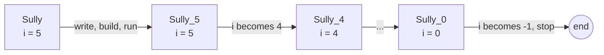
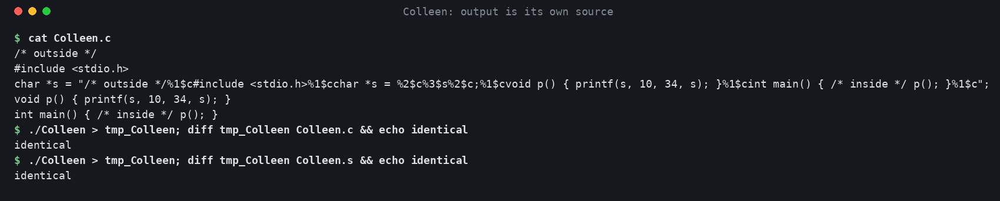
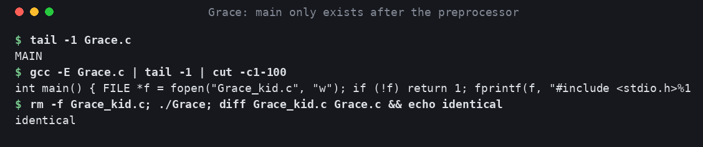
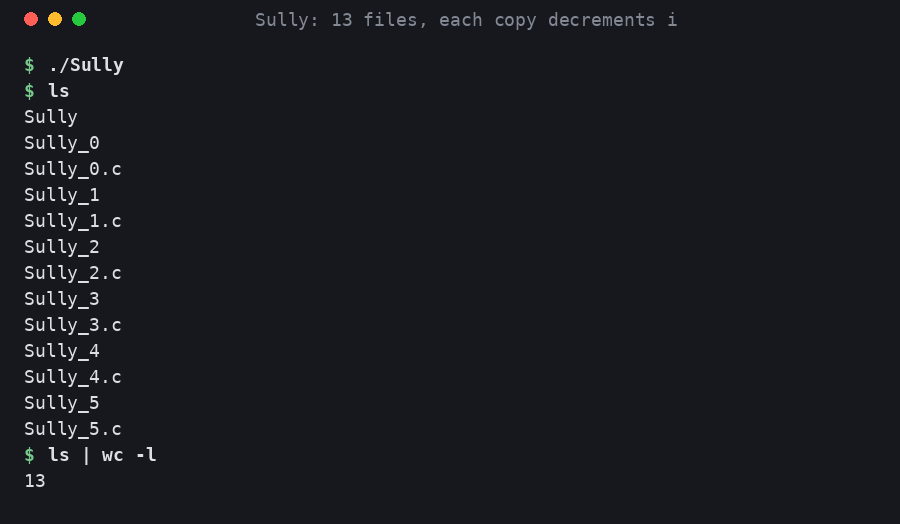
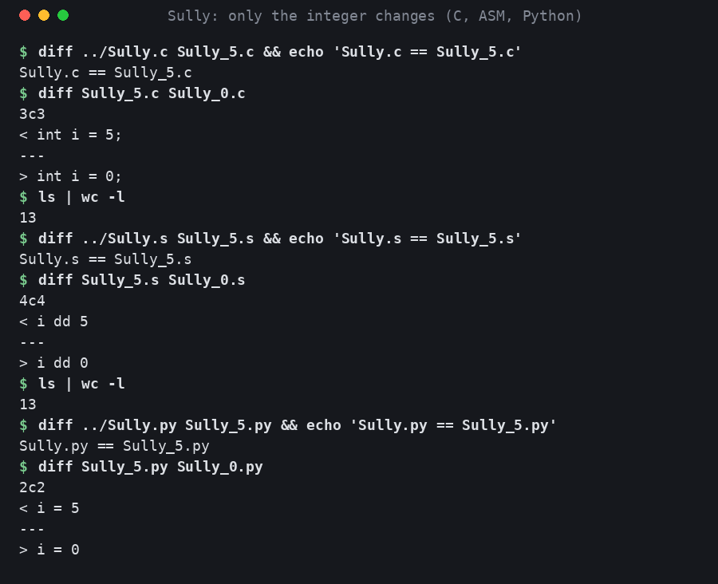

# dr-quine

Programs that print or copy their own source code, written in C, x86-64 assembly and Python.


A quine is a program whose output is its own source. It does not read its file or take any input. This repo has three of them, each in three languages:

| Program | What it does |
|---|---|
| `Colleen` | prints its own source to stdout |
| `Grace` | writes its own source to `Grace_kid.c`, `Grace_kid.s` or `Grace_kid.py` |
| `Sully` | writes a copy of itself with a smaller integer, builds it and runs it, until the integer reaches 0 |

## Quick start

You need `gcc`, `nasm`, `make` and `python3` on Linux x86-64.

```sh
git clone https://github.com/bahbibe/dr-quine.git
cd dr-quine
make -C C
make -C ASM

# Colleen: the output must match the source
./C/Colleen > /tmp/out.c && diff /tmp/out.c C/Colleen.c
./ASM/Colleen > /tmp/out.s && diff /tmp/out.s ASM/Colleen.s
python3 Python/Colleen.py | diff - Python/Colleen.py
```

Grace and Sully write files, so run them in an empty folder:

```sh
mkdir /tmp/run && cp C/Sully /tmp/run && cd /tmp/run
./Sully
ls | wc -l                                   # 13
diff Sully_5.c Sully_0.c                     # only "int i" changes
```

The ASM build prints a linker warning about `.note.GNU-stack`. It is expected. The programs work. See the notes below.

On a clean clone, the C and ASM builds take about half a second. All nine programs pass their checks.

## How Sully works



The result is 13 files: `Sully` plus a source and a binary for each of `Sully_5` to `Sully_0`.

## Screenshots

| | |
|---|---|
|  | `Colleen` in C and ASM. The `diff` of its output against its source is empty. |
|  | `Grace` has no `main` in its source. The preprocessor creates it from the `MAIN` macro. |
|  | One run of `Sully` leaves 13 files. |
|  | In C, ASM and Python, `Sully_5` equals `Sully`, and `Sully_0` differs only in the integer. |

## Notable bits

**One printf call rebuilds the whole file.** Every C and ASM program stores its source as one string `s` and calls `printf(s, 10, 34, s)`. The string uses positional arguments: `%1$c` is a newline (10), `%2$c` is a quote (34) and `%3$s` is the string itself. Each value is passed once and reused by index. In assembly, three values fit in registers, so there is no argument table and no loop. `Colleen.c` is 5 lines and `Colleen.s` is 16.

**Sully tells a copy from the original without reading a file.** The source of `Sully` and of `Sully_5` must be identical, but only a copy may decrement. The program checks the letter before `.c` in `__FILE__`. It is `y` in `Sully.c` and a digit in `Sully_5.c`. A first version compared the whole name with `strcmp`. It broke when built as `gcc ../Sully.c`, because `__FILE__` is then `../Sully.c`, and the chain gave 11 files instead of 13. Reading from the end of the name works at any path.

**Grace-ASM has no routine and no declared `main`.** The body of `main`, label included, lives inside a NASM `%macro`. With no `call` to a helper, the stack is 8 bytes off for libc, so `fprintf` crashed. One `push rbx` fixes this and also keeps the `FILE*` safe across calls. The C version does the same with three `#define` lines (`S`, `F`, `MAIN`).

**Small, on purpose.** All nine programs are 152 lines in total. The C and ASM versions have the same steps in the same order, so you can read the C first and follow the assembly line by line.

**Errors are handled.** If `Grace` or `Sully` cannot write their file, they exit with code 1. They do not crash. Test it with `mkdir ro && cp Grace ro && chmod 555 ro && cd ro && ./Grace; echo $?`.

**The linker warning.** The ASM files leave out the `.note.GNU-stack` section line to stay short. `ld` then warns that the stack is implied executable. Add `section .note.GNU-stack noalloc noexec nowrite progbits` at the end of a `.s` file, or link with `gcc -z noexecstack`, to silence it.

## Layout

```
C/        Colleen.c  Grace.c  Sully.c  Makefile
ASM/      Colleen.s  Grace.s  Sully.s  Makefile
Python/   Colleen.py Grace.py Sully.py
```

Each Makefile has `all`, `clean`, `fclean` and `re`. `Python/` has no Makefile because nothing needs building. Python has no preprocessor, so Grace uses three constants and `exec` in place of the three macros.

## Background

- [Quine (computing)](https://en.wikipedia.org/wiki/Quine_(computing))
- [Kleene's recursion theorem](https://en.wikipedia.org/wiki/Kleene%27s_recursion_theorem): why a quine exists in any Turing-complete language.
- `man 3 printf`: positional arguments (`%1$c`).

## License

MIT. See [LICENSE](LICENSE).
